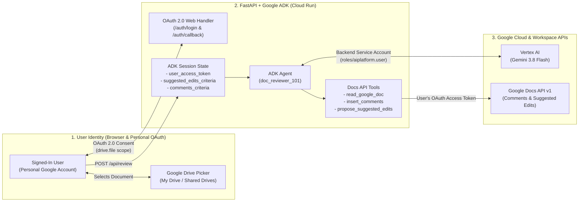
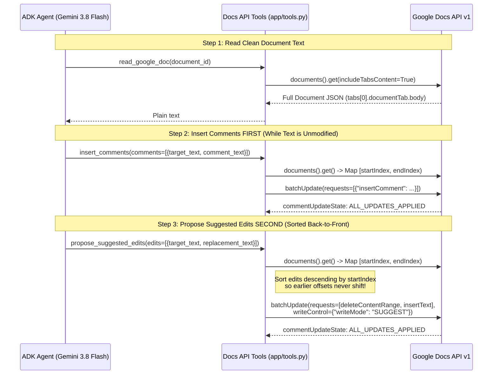

# Building an AI Document Reviewer with Google ADK, Gemini, and the New Google Docs Comments & Suggested Edits API

*How to build and deploy a multi-user Google Docs review web app that signs in with your personal Google account, browses Drive with the Google Picker, and uses Gemini on Vertex AI to leave real inline Suggested Edits and Margin Comments.*

---

### Suggested Titles for Publication
1. **Building an AI Editor for Google Docs with ADK, Gemini, and the New Suggested Edits & Comments API**
2. **Stop Overwriting Docs: How to Build a Human-in-the-Loop Google Docs AI Reviewer on Cloud Run**
3. **From Raw Text to Native Suggested Edits: Automating Google Docs Reviews with Google ADK and Vertex AI**
4. **How to Build a Self-Hosted Google Docs AI Reviewer Using Personal OAuth, Google Drive Picker, and Gemini**

---

## Introduction: Why AI Document Review Used to Be Broken

Until recently, integrating Large Language Models (LLMs) into a Google Docs editorial workflow meant choosing between two frustrating compromises:

1. **The Copy-Paste Chat Loop**: You copy paragraphs out of Google Docs, paste them into an AI chat window, ask for feedback, and manually copy the edits back into your document—losing formatting, tables, and collaborative context.
2. **Destructive API Overwrites**: You write a script using the Google Docs API (`deleteContentRange` and `insertText`), and the bot silently overwrites the author's original prose. Authors hate this because they cannot easily see *what* changed, *why* it changed, or reject a bad rewrite without digging through version history.

When human editors review a Google Doc, they don't silently overwrite your text. They use two distinct native primitives:
- **Suggested Edits** for objective, mechanical improvements (typos, grammar mistakes, awkward phrasing) that the author can **Accept (✓)** or **Reject (✗)** with one click.
- **Anchored Margin Comments** for high-level editorial feedback (unverified claims, missing citations, ambiguous timelines) that require discussion or author clarification.

With the **Google Docs API updates introducing programmatic Comments (`insertComment`) and Suggested Edits (`writeControl: {"writeMode": "SUGGEST"}`)**, AI agents can finally participate in Google Docs as first-class human-in-the-loop collaborators.

In this tutorial, we will walk through the architecture, code, and step-by-step Cloud Run deployment of **`doc-reviewer-101`**—an open-source web application powered by the **Google Agent Development Kit (ADK)** and **Gemini 3.8 Flash on Vertex AI** that anyone can deploy in their own Google Cloud project to review their personal or team Google Docs.

---

## What We Will Cover

1. **The Dual-Identity Architecture**: How to combine a **Personal Google Account (OAuth 2.0)** for Google Docs access with a **Google Cloud Service Account** for Vertex AI Gemini inference—so you never have to share personal documents with a bot email address.
2. **The Mechanics of the New Google Docs API**:
   - How to anchor comments to exact text spans using `insertComment`.
   - How to turn standard `deleteContentRange` + `insertText` operations into green/pink **Suggested Edits** using `writeControl: {"writeMode": "SUGGEST"}`.
   - Why **Order of Operations** (`read` → `comment` → `suggest edits`) and **Reverse-Index Sorting** are mandatory to prevent character index drift.
3. **Customizable Review Templates with ADK State**: How to let users define their own review rubrics in the browser and dynamically inject them into the ADK agent's system instructions.
4. **Integrating the Google Drive Picker**: Letting users visually browse **My Drive** and **Shared Drives** while using the least-privilege, non-sensitive `drive.file` OAuth scope.
5. **Step-by-Step Guide**: Running locally and deploying to **Google Cloud Run** so your whole team can use it.

---

## 1. Architecture Deep Dive

### The Dual-Identity Security Model

A common stumbling block when building Google Workspace AI apps on Google Cloud is identity management:
- **Gemini on Vertex AI** lives inside your Google Cloud project and is billed to your GCP account.
- **Your Google Docs** live inside your personal `@gmail.com` or Google Workspace account.

If you used a GCP Service Account to call the Google Docs API, every user would have to manually copy the Service Account's long `.iam.gserviceaccount.com` email address and share their document with it before every review. Even worse, every comment in the document would show up as authored by a service account rather than the reviewer.

Instead, our application uses a **Dual-Identity Architecture**:



1. **Identity 1 — The Backend Service Account (`doc-reviewer-sa`)**: Attached to the Cloud Run service (or your local Application Default Credentials). It has `roles/aiplatform.user` permission and is used *exclusively* by the ADK `Runner` to invoke **Gemini 3.8 Flash** on Vertex AI.
2. **Identity 2 — The Logged-In User's OAuth 2.0 Token**: When the user clicks **Sign in with Google** in the web UI, the FastAPI backend obtains an OAuth 2.0 access token and passes it into the ADK `session.state["user_access_token"]`. When the agent invokes `read_google_doc`, `insert_comments`, or `propose_suggested_edits`, those tools authenticate to the Google Docs API using the **user's token**.

---

## 2. Under the Hood of the Google Docs API: Indices, Comments, and Suggested Edits

If you have ever worked with the Google Docs API, you know that it does not operate on simple line numbers or markdown strings. Instead, a Google Document is a tree of structural elements (`paragraph`, `table`, `textRun`), where every character has a **1-based UTF-16 offset (`startIndex` and `endIndex`)**.

When building an AI agent that applies both **Comments** and **Suggested Edits**, three critical engineering rules determine whether your agent succeeds or corrupts character offsets:

### Rule 1: Read from `tabs[0].documentTab.body` When `includeTabsContent=True`
Modern Google Docs support multiple document tabs. When you call `documents().get(..., includeTabsContent=True)`, the Google Docs API moves the body content out of the legacy top-level `doc["body"]` field and places it inside `doc["tabs"][0]["documentTab"]["body"]`.

Furthermore, structural boundaries (like section breaks, table cells, and paragraphs) increment the document index counter even when they don't appear in plain text. Rather than guessing indices with `str.index()`, our helper `_extract_text_and_index_map()` walks every `textRun` in the document and builds a parallel array (`doc_indices`) that records the exact 1-based Google Docs index of every single character:

```python
def _extract_text_and_index_map(doc: Dict[str, Any]) -> Tuple[str, List[int]]:
    """Extracts plain text and maps each character to its exact 1-based Docs API index."""
    tabs = doc.get("tabs", [])
    if tabs:
        body = tabs[0].get("documentTab", {}).get("body", {})
    else:
        body = doc.get("body", {})

    chars: List[str] = []
    doc_indices: List[int] = []

    def _walk_elements(content_list: List[Dict[str, Any]]):
        for element in content_list:
            if "paragraph" in element:
                for run in element["paragraph"].get("elements", []):
                    text_run = run.get("textRun")
                    if text_run and "content" in text_run:
                        text = text_run["content"]
                        start_idx = run.get("startIndex", 1)
                        for offset, ch in enumerate(text):
                            chars.append(ch)
                            doc_indices.append(start_idx + offset)
            elif "table" in element:
                for row in element["table"].get("tableRows", []):
                    for cell in row.get("tableCells", []):
                        _walk_elements(cell.get("content", []))

    _walk_elements(body.get("content", []))
    return "".join(chars), doc_indices
```

With `doc_indices` in hand, finding the exact `[startIndex, endIndex)` for any target phrase the LLM wants to highlight or edit takes four lines of code:

```python
def _find_doc_range(
    full_text: str, doc_indices: List[int], target_text: str
) -> Tuple[int, int] | None:
    pos = full_text.find(target_text)
    if pos == -1 or not target_text:
        return None
    start_index = doc_indices[pos]
    end_index = doc_indices[pos + len(target_text) - 1] + 1
    return start_index, end_index
```

### Rule 2: Always Insert Comments *Before* Proposing Suggested Edits
Why does tool execution order matter so much?

When you propose a **Suggested Edit** in Google Docs using `writeControl: {"writeMode": "SUGGEST"}`:
- The `deleteContentRange` request **does not actually delete the text** from the document's underlying representation. It marks the characters as *suggested for deletion*.
- The `insertText` request inserts the new replacement characters right next to the old characters as *suggested for insertion*.

When the document is subsequently read with `suggestionsViewMode="SUGGESTIONS_INLINE"`, `"teh"` replaced by `"the"` actually appears in the inline text stream as `"tehthe"`!



If `propose_suggested_edits` ran *before* `insert_comments`, any typo fixed inside a sentence would mutate that sentence's inline text and prevent `insert_comments` from matching the sentence! By instructing the agent to run **`insert_comments` first** (which only attaches metadata anchors without altering characters) and **`propose_suggested_edits` second**, both tools match 100% of their target phrases reliably.

### Rule 3: Sort Batch Suggested Edits from Back to Front (`reverse=True`)
Suppose the agent proposes 8 spelling and grammar edits across a 3-page document in a single `batchUpdate` call. If you apply an edit at character index `50` that replaces a 4-letter word with a 7-letter word, every single character index after `50` immediately shifts by `+3`!

To prevent earlier edits from invalidating the character coordinates of later edits in the same batch, `propose_suggested_edits` sorts all resolved ranges in **descending order of `startIndex`** (`reverse=True`) and filters out any overlapping spans before building the `batchUpdate` payload:

```python
# Sort descending by startIndex and filter out overlapping ranges
resolved_edits.sort(key=lambda x: x["startIndex"], reverse=True)
non_overlapping = []
last_start = float("inf")
for item in resolved_edits:
    if item["endIndex"] <= last_start:
        non_overlapping.append(item)
        last_start = item["startIndex"]
```

Then, turning those `deleteContentRange` and `insertText` pairs into native Google Docs **Suggested Edits** requires just a single top-level property on the `batchUpdate` body:

```python
response = (
    service.documents()
    .batchUpdate(
        documentId=document_id,
        body={
            "requests": requests,
            "writeControl": {"writeMode": "SUGGEST"},
        },
    )
    .execute()
)
```

---

## 3. Dynamic Review Templates with Google ADK

Different documents require different editorial lenses. A software engineering design doc needs scrutiny on architecture trade-offs and latency numbers, whereas a marketing blog post needs scrutiny on tone, active voice, and brand terminology.

In [`app/agent.py`](file:///Users/romin/doc-reviewer-101/app/agent.py), we take advantage of **Google ADK's State Templating**. When you include `{comments_criteria}` and `{suggested_edits_criteria}` inside an ADK agent's `instruction` string, ADK automatically interpolates those placeholders from `session.state` at runtime:

```python
# app/agent.py
from google.adk.agents import Agent
from google.adk.agents.callback_context import CallbackContext
from google.adk.apps import App

from app.tools import insert_comments, propose_suggested_edits, read_google_doc

DEFAULT_SUGGESTED_EDITS_CRITERIA = (
    "- Spelling mistakes and typos.\n"
    "- Grammatical errors (such as subject-verb disagreement, tense errors, or punctuation).\n"
    "- Awkward or redundant word choices."
)

DEFAULT_COMMENTS_CRITERIA = (
    "- Exaggerated or unverified claims that lack citations or benchmark data.\n"
    "- Unrealistic timelines or vague action items that need clear owners or dates.\n"
    "- Sections that are ambiguous and require clarification from the author."
)


def ensure_review_criteria_defaults(callback_context: CallbackContext):
    """Populates default review templates in session state if the user didn't override them."""
    if not callback_context.state.get("suggested_edits_criteria"):
        callback_context.state["suggested_edits_criteria"] = (
            DEFAULT_SUGGESTED_EDITS_CRITERIA
        )
    if not callback_context.state.get("comments_criteria"):
        callback_context.state["comments_criteria"] = DEFAULT_COMMENTS_CRITERIA
    return None


INSTRUCTION = """
You are an AI Document Reviewer for Google Docs.
When given a Google Document ID, execute these steps in exact order:

1. READ:
   Call `read_google_doc` to retrieve the document's text.

2. COMMENT FIRST (Based on User's Comment Criteria):
   Review the document against these specific Comment Criteria:
   {comments_criteria}

   If any phrases or sentences match the Comment Criteria above, call `insert_comments` first with the exact `target_text` from the document and helpful `comment_text`.

3. SUGGEST EDITS SECOND (Based on User's Suggested Edits Criteria):
   Review the document against these specific Suggested Edits Criteria:
   {suggested_edits_criteria}

   If any words or phrases need correction based on the Suggested Edits Criteria above, call `propose_suggested_edits` with each exact `target_text` and its `replacement_text`.
   Include 1-2 surrounding words in `target_text` if a typo is a short word (like "teh") to ensure unique matching.

4. SUMMARIZE:
   Return a clear summary of all comments and suggested edits applied, and provide the link:
   https://docs.google.com/document/d/<DOCUMENT_ID>/edit
"""

root_agent = Agent(
    name="doc_reviewer_101",
    model="gemini-3.8-flash",
    description="Reviews a Google Doc based on customizable criteria and adds comments and suggested edits.",
    instruction=INSTRUCTION,
    tools=[read_google_doc, insert_comments, propose_suggested_edits],
    before_agent_callback=ensure_review_criteria_defaults,
)

app = App(root_agent=root_agent, name="app")
```

Notice the `before_agent_callback=ensure_review_criteria_defaults`: if you test the agent from the CLI or ADK playground where no custom web criteria were submitted, the callback automatically populates the default templates so `{comments_criteria}` and `{suggested_edits_criteria}` always resolve cleanly.

---

## 4. Integrating the Native Google Drive Picker

Instead of forcing users to copy-paste document IDs out of browser URLs—or querying `drive.files.list` with a simple dropdown that caps out at a single page of files—our web UI integrates the official **Google Drive Picker API (`gapi.load('picker')`)**:

1. **Full Drive Navigation & Search**: Users get the native Google Drive modal with folder navigation, search, **My Drive**, and **Shared Drives** tabs.
2. **Better Security with `drive.file`**: When a user selects a document inside the Google Drive Picker (configured with `.setAppId(GOOGLE_CLOUD_PROJECT_NUMBER)`), Google automatically grants your OAuth Client ID `drive.file` access to that specific document. Because `https://www.googleapis.com/auth/drive.file` is classified by Google as a **Non-Sensitive** scope, external users won't face a scary "Google hasn't verified this app" warning screen when you publish your app!

---

## 5. Step-by-Step Guide: Deploy Your Own Google Docs AI Reviewer

Ready to run this in your own Google Cloud project? Follow the steps below to run it locally and deploy it to **Google Cloud Run**.

### Prerequisites
- A **Google Cloud Project** with billing enabled.
- **[Google Cloud SDK (`gcloud`)](https://cloud.google.com/sdk/docs/install)** installed.
- **Python 3.11+** and **[uv](https://docs.astral.sh/uv/getting-started/installation/)** installed.

---

### Step 1: Clone the Project & Enable Google Cloud APIs

Clone the repository and install dependencies with `uv`:

```bash
git clone https://github.com/rominirani/doc-reviewer-101.git
cd doc-reviewer-101
uv sync
```

Next, set your Google Cloud Project ID and enable the required APIs:
- **Vertex AI API (`aiplatform.googleapis.com`)**: Runs Gemini 3.8 Flash via ADK.
- **Google Docs API (`docs.googleapis.com`)**: Reads docs and writes comments & suggested edits.
- **Google Drive API (`drive.googleapis.com`)** & **Google Picker API (`picker.googleapis.com`)**: Powers the Google Drive file picker.
- **Cloud Run (`run.googleapis.com`)** & **Cloud Build (`cloudbuild.googleapis.com`)**: Builds and hosts the web container.

```bash
export PROJECT_ID="your-gcp-project-id"
gcloud config set project "${PROJECT_ID}"

gcloud services enable \
  aiplatform.googleapis.com \
  docs.googleapis.com \
  drive.googleapis.com \
  picker.googleapis.com \
  run.googleapis.com \
  cloudbuild.googleapis.com \
  --project="${PROJECT_ID}"
```

Also retrieve your **Google Cloud Project Number** (you'll need this for `.env`):

```bash
gcloud projects describe "${PROJECT_ID}" --format="value(projectNumber)"
```

---

### Step 2: Configure the Google OAuth Consent Screen

Because the web app signs you in with your personal Google account, configure your project's OAuth consent screen once:

1. Open **[Google Auth Platform → Overview](https://console.cloud.google.com/auth/overview)** in the Google Cloud Console.
2. Click **Get Started**:
   - **App name**: `Google Docs AI Reviewer`
   - **User support email**: Choose your email address.
   - **Audience**: Select **External** (this allows you to sign in with any personal `@gmail.com` account).
   - **Contact Information**: Enter your email address and click **Create**.
3. In the left navigation menu, click **[Audience](https://console.cloud.google.com/auth/audience)**:
   - Under **Test users**, click **+ Add users** and enter your personal Google account email address (plus any teammates you want to invite).

---

### Step 3: Create Your OAuth 2.0 Web Client ID

Now create the OAuth 2.0 client that handles the `/auth/login` and `/auth/callback` endpoints:

1. Open **[APIs & Services → Credentials](https://console.cloud.google.com/apis/credentials)**.
2. Click **+ Create Credentials → OAuth client ID**.
3. Select **Application type**: `Web application` and name it `Docs Reviewer Web Client`.
4. Under **Authorized JavaScript origins**, click **+ Add URI**:
   ```text
   http://localhost:8000
   ```
5. Under **Authorized redirect URIs**, click **+ Add URI**:
   ```text
   http://localhost:8000/auth/callback
   ```
6. Click **Create** and copy the **Client ID** and **Client Secret**.

---

### Step 4: Create a Browser API Key for the Google Drive Picker

The client-side Google Drive Picker modal requires a Browser API Key:

1. Stay on **[APIs & Services → Credentials](https://console.cloud.google.com/apis/credentials)** and click **+ Create Credentials → API key**.
2. Copy the generated key (`AIzaSy...`).
3. Click **Edit API key** to secure it:
   - Under **Application restrictions**, choose **Websites** and add:
     - `http://localhost:8000/*`
     - `http://127.0.0.1:8000/*`
   - Under **API restrictions**, select **Restrict key** and check **both**:
     - **Google Picker API**
     - **Google Drive API**
   - Click **Save**.

> **Common Pitfall**: If you restrict your API key by API and forget to enable `picker.googleapis.com` or forget to check **Google Picker API** in the dropdown, clicking *Browse Google Drive* will display `"The API developer key is invalid."`

---

### Step 5: Configure `.env` and Test Locally

Copy `.env.example` to `.env` and fill in your values:

```bash
cp .env.example .env
```

```dotenv
GOOGLE_GENAI_USE_VERTEXAI=TRUE
GOOGLE_CLOUD_PROJECT="your-gcp-project-id"
GOOGLE_CLOUD_LOCATION="global"
GOOGLE_CLOUD_PROJECT_NUMBER="your-gcp-project-number"

OAUTH_CLIENT_ID="your-oauth-client-id.apps.googleusercontent.com"
OAUTH_CLIENT_SECRET="GOCSPX-your-oauth-client-secret"
OAUTH_REDIRECT_URI="http://localhost:8000/auth/callback"

GOOGLE_PICKER_API_KEY="AIzaSy-your-browser-api-key"
```

Authenticate your local environment for Vertex AI and start the server:

```bash
gcloud auth application-default login
uv run uvicorn app.fast_api_app:app --reload --port 8000
```

Open **`http://localhost:8000/reviewer`** in your browser:
1. Click **Sign in with Google** and sign in with your personal account.
2. Click **Browse Google Drive** to open the Google Drive Picker and pick any Google Doc.
3. Customize the **Suggested Edits Criteria** and **Editorial Comments Criteria** textareas (or leave the default templates).
4. Click **Run AI Review**. Within ~15–20 seconds, you will see a summary of all edits and comments applied, along with an **Open Reviewed Google Doc** button!

---

### Step 6: Deploy to Google Cloud Run for Multi-User Access

To share the reviewer with colleagues or use it from anywhere without running a local server, deploy it to **Google Cloud Run**.

Our FastAPI app (`app/fast_api_app.py`) includes automatic proxy header detection (`_get_redirect_uri`):
- When `OAUTH_REDIRECT_URI` is set in `.env` locally, it uses `http://localhost:8000/auth/callback`.
- When deployed to Cloud Run (where `OAUTH_REDIRECT_URI` is omitted), it reads the `x-forwarded-proto` (`https`) and `host` headers to automatically construct `https://<your-cloud-run-service>.run.app/auth/callback`.

Run the included `deploy.sh` script:

```bash
chmod +x deploy.sh
./deploy.sh
```

Under the hood, `deploy.sh`:
1. Creates a dedicated least-privilege service account (`doc-reviewer-sa@<PROJECT_ID>.iam.gserviceaccount.com`).
2. Grants it `roles/aiplatform.user` (so the Cloud Run container can call Gemini on Vertex AI).
3. Deploys the container using `gcloud run deploy --source .` with `--max-instances=1` (ensuring in-memory OAuth sessions stay pinned to the active instance).

#### Final Console Step After Deployment
When `deploy.sh` finishes, it prints your live Cloud Run **Service URL** (e.g., `https://doc-reviewer-101-xxxxx.us-central1.run.app`). Add that URL to your credentials in **[APIs & Services → Credentials](https://console.cloud.google.com/apis/credentials)**:

1. **In your OAuth 2.0 Web Client**:
   - Add `https://YOUR-CLOUD-RUN-URL.run.app` under **Authorized JavaScript origins**.
   - Add `https://YOUR-CLOUD-RUN-URL.run.app/auth/callback` under **Authorized redirect URIs**.
2. **In your Browser API Key** (if using Website restrictions):
   - Add `https://YOUR-CLOUD-RUN-URL.run.app/*` under **Website restrictions**.

Wait ~60 seconds for the OAuth settings to propagate, then visit your Cloud Run URL!

---

## Conclusion

By combining the **Google Agent Development Kit (ADK)** with the new **Google Docs API Comments (`insertComment`) and Suggested Edits (`writeControl: {"writeMode": "SUGGEST"}`)**, we can move beyond chat-based copy-pasting and build AI agents that collaborate inside Google Docs just like a thoughtful human colleague.

Because the author remains in full control—accepting or rejecting each inline suggestion and replying to margin comments—teams get the speed of Gemini 3.8 Flash without ever sacrificing editorial ownership.
