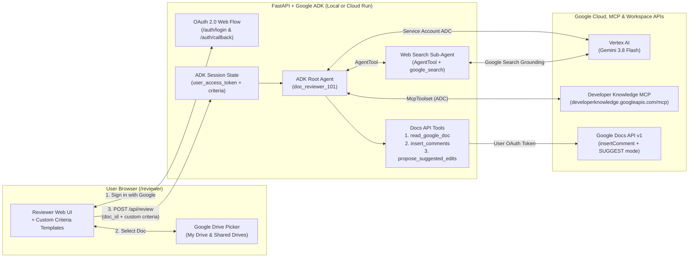

# Google Docs AI Reviewer & Fact-Checker (`doc-reviewer-101`)

An AI-powered Google Docs Review and Hybrid Fact-Checking Web Application built with the **Google Agent Development Kit (ADK)**, **Gemini 3.8 Flash on Vertex AI**, **Google Developer Knowledge MCP Server**, **Google Search Grounding**, **Google Drive Picker**, and the new **Google Docs API programmatic Comments & Suggested Edits** capabilities.

> **Repository & Cloud Run Deployment Note**: This repository contains the complete, production-ready code for both the core **Google Docs AI Reviewer** ( inline Suggested Edits + Margin Comments + Google Drive Picker) and the **Hybrid Fact-Checker** upgrade (Google Developer Knowledge Remote MCP Server + Google Search Grounding via ADK `AgentTool`). All configuration files (`pyproject.toml`, `Dockerfile`, and `deploy.sh`) are fully updated so anyone can run the app locally or deploy their own instance to **Google Cloud Run** with a single command (`./deploy.sh`).

Instead of destructively overwriting your document text or dumping feedback into a separate chat window, this agent collaborates inside Google Docs like a real human editor and technical fact-checker:
1. **Hybrid Fact-Checking & Citation Grounding**:
   - Verifies **Google Cloud, Gemini, ADK, Firebase, Android, Chrome, Flutter, and Go** claims against official documentation via the **Google Developer Knowledge Remote MCP Server** (`https://developerknowledge.googleapis.com/mcp`).
   - Verifies **general public facts, release dates, and industry statistics** via **Google Search Grounding (`google_search`)** wrapped in an ADK `AgentTool`.
2. **Attaches Editorial & Citation Comments (`insertComment`)** anchored to exact sentences or claims in your document margin—including the verified source URLs.
3. **Proposes Inline Suggested Edits (`writeControl: {"writeMode": "SUGGEST"}`)** for outdated numbers, wrong CLI flags, typos, grammar, and style improvements that you can **Accept (✓)** or **Reject (✗)** with a single click.
4. **Customizable Review Templates**: Define your own criteria for what the agent should flag as a *Comment* versus fix as a *Suggested Edit* directly in the Web UI.
5. **Personal Google Account + Google Drive Picker**: Sign in with your own Google account, browse **My Drive** or **Shared Drives** via the native Google Drive Picker modal, and review any Google Doc you have access to—so every comment and suggested edit appears under your name.

---

## Architecture Overview



### Dual-Identity Security Model
This project uses two distinct identities so you never have to share personal Google Docs with a backend service account:
- **Your Personal Google Account (OAuth 2.0 Token)**: Used *exclusively* by the Google Drive Picker and Google Docs API tools (`read_google_doc`, `insert_comments`, `propose_suggested_edits`) so the agent only accesses documents you select, and all comments/suggestions are authored by you.
- **Google Cloud Project / Service Account (ADC)**: Used *exclusively* by the ADK `Runner` on the backend to call **Gemini 3.8 Flash** on Vertex AI (`aiplatform.googleapis.com`) and the **Google Developer Knowledge MCP Server** (`developerknowledge.googleapis.com`).

---

## Project Structure

```text
doc-reviewer-101/
├── app/
│   ├── agent.py               # ADK Root Agent, Developer Knowledge MCP Toolset, Search AgentTool & prompts
│   ├── tools.py               # Google Docs API v1 tools (1-based index mapping, comments, suggested edits)
│   ├── fast_api_app.py        # FastAPI server, Google OAuth 2.0 flow, Google Drive Picker UI (/reviewer)
│   └── app_utils/             # ADK Runner, A2A routes, and telemetry helpers
├── tests/                     # Unit and integration tests
├── .env.example               # Template for local and Cloud Run environment variables
├── deploy.sh                  # Automated one-command Cloud Run deployment script
├── Dockerfile                 # Production container image using Python 3.12 and uv
└── pyproject.toml             # Python dependencies managed by uv (including google-adk & mcp)
```

---

## Prerequisites

1. **Python 3.11+** and **[uv](https://docs.astral.sh/uv/getting-started/installation/)** (`curl -LsSf https://astral.sh/uv/install.sh | sh`)
2. **[Google Cloud SDK (`gcloud`)](https://cloud.google.com/sdk/docs/install)**
3. A **Google Cloud Project** with billing enabled
4. A **Personal Google Account** (Gmail or Google Workspace) with Google Docs to test

---

## Step-by-Step Setup Guide

### Step 1: Clone the Repository & Install Dependencies

```bash
git clone https://github.com/rominirani/doc-reviewer-101.git
cd doc-reviewer-101
uv sync
```

### Step 2: Enable Required Google Cloud APIs

Set your Google Cloud Project ID and enable the required APIs (including `developerknowledge.googleapis.com` for the Developer Knowledge MCP Server):

```bash
export PROJECT_ID="your-gcp-project-id"
gcloud config set project "${PROJECT_ID}"

gcloud services enable \
  aiplatform.googleapis.com \
  developerknowledge.googleapis.com \
  docs.googleapis.com \
  drive.googleapis.com \
  picker.googleapis.com \
  run.googleapis.com \
  cloudbuild.googleapis.com \
  --project="${PROJECT_ID}"
```

Also look up your **Google Cloud Project Number** (needed for the Google Drive Picker):

```bash
gcloud projects describe "${PROJECT_ID}" --format="value(projectNumber)"
```

---

### Step 3: Configure Google OAuth Consent Screen

1. Open the **[Google Auth Platform — Overview](https://console.cloud.google.com/auth/overview)** in the Google Cloud Console.
2. If prompted, click **Get Started**:
   - **App name**: `Google Docs AI Reviewer`
   - **User support email**: Select your email address.
   - **Audience**: Select **External** (so any personal `@gmail.com` account can sign in).
   - **Contact Information**: Enter your email address and finish creating.
3. Open **[Audience](https://console.cloud.google.com/auth/audience)** in the left sidebar:
   - Under **Test users**, click **+ Add users** and add your personal Google account email (and any friends/teammates who will test the app).

---

### Step 4: Create OAuth 2.0 Web Client Credentials

1. Go to **[APIs & Services → Credentials](https://console.cloud.google.com/apis/credentials)**.
2. Click **+ Create Credentials → OAuth client ID**.
3. Choose **Application type**: `Web application` and name it `Docs Reviewer Web Client`.
4. Under **Authorized JavaScript origins**, click **+ Add URI** and add:
   ```text
   http://localhost:8000
   ```
5. Under **Authorized redirect URIs**, click **+ Add URI** and add:
   ```text
   http://localhost:8000/auth/callback
   ```
6. Click **Create** and copy both your **Client ID** (`OAUTH_CLIENT_ID`) and **Client Secret** (`OAUTH_CLIENT_SECRET`).

---

### Step 5: Create a Browser API Key for Google Drive Picker

The Google Drive Picker UI requires a browser API key with the **Google Picker API** enabled.

1. On the **[APIs & Services → Credentials](https://console.cloud.google.com/apis/credentials)** page, click **+ Create Credentials → API key**.
2. Copy the generated key (`AIzaSy...`).
3. *(Recommended)* Click **Edit API key** to restrict it:
   - Under **Application restrictions**, select **Websites** and add:
     - `http://localhost:8000/*`
   - Under **API restrictions**, select **Restrict key** and check:
     - **Google Picker API**
     - **Google Drive API**
   - Click **Save**.

---

### Step 6: Configure Your `.env` File

Copy `.env.example` to `.env` and fill in the values from Steps 2–5:

```bash
cp .env.example .env
```

```dotenv
GOOGLE_GENAI_USE_VERTEXAI=TRUE
GOOGLE_CLOUD_PROJECT="your-gcp-project-id"
GOOGLE_CLOUD_LOCATION="global"
GOOGLE_CLOUD_PROJECT_NUMBER="your-gcp-project-number"

OAUTH_CLIENT_ID="your-oauth-client-id.apps.googleusercontent.com"
OAUTH_CLIENT_SECRET="GOCSPX-your-oauth-client-secret"
OAUTH_REDIRECT_URI="http://localhost:8000/auth/callback"

GOOGLE_PICKER_API_KEY="AIzaSy-your-browser-api-key"
```

---

## Running Locally

1. Authenticate your local machine with Google Cloud for Vertex AI and Developer Knowledge MCP calls:
   ```bash
   gcloud auth application-default login
   ```
2. Start the FastAPI server:
   ```bash
   uv run uvicorn app.fast_api_app:app --reload --port 8000
   ```
3. Open **[http://localhost:8000/reviewer](http://localhost:8000/reviewer)** in your browser:
   - Click **Sign in with Google** and approve access.
   - Click **Browse Google Drive** to select a Google Doc from **My Drive** or **Shared Drives** (or paste a Document ID directly).
   - Customize the **Suggested Edits Criteria** and **Editorial Comments Criteria** (or keep the defaults).
   - Click **Run AI Review** and then click **Open Reviewed Google Doc** to inspect the inline suggested edits and comments!

### Sample Test Document to Try Out
Create a new Google Doc and paste these two paragraphs containing deliberate Cloud Run quota myths, a wrong `gcloud` CLI flag, an incorrect Python 3.12 release date, and typos:

```text
Project Proposal: Migrating Our Analytics API to Google Cloud Run

Our engineering team plans to migrate our Python backend to Google Cloud Run next month. Currently, our batch jobs take 25 minutes to complete, which is a problem because Cloud Run services only support a maximum request timeout of 15 minutes and a maximum memory limit of 8 GiB per instance. To deploy the container publicly from source, engineers will run gcloud run deploy my-api --source . --public-access.

For runtime language support, we are standardizing on Python 3.12, which was officially released in October 2021. We beleive this migration will immediatly reduce our monthly infrastructure bill by 95% within the first week without requiring any load testing.
```

---

## Deploying to Google Cloud Run

You can deploy this application to **Google Cloud Run** so others can access it via an HTTPS URL and review their own Google Docs.

### 1. Run the Deployment Script

Make `deploy.sh` executable and run it:

```bash
chmod +x deploy.sh
./deploy.sh
```

What `deploy.sh` does automatically:
- Enables all required Google Cloud APIs (`aiplatform`, `developerknowledge`, `docs`, `drive`, `picker`, `run`, `cloudbuild`).
- Creates a dedicated least-privilege runtime service account (`doc-reviewer-sa@<PROJECT_ID>.iam.gserviceaccount.com`) with `roles/aiplatform.user`, `roles/serviceusage.serviceUsageConsumer`, `roles/logging.logWriter`, and `roles/cloudtrace.agent`.
- Deploys the container to Cloud Run with `--min-instances=0` (scales to zero when idle so you pay nothing when unused) and `--max-instances=1` (for in-memory session consistency), while omitting `OAUTH_REDIRECT_URI` so the FastAPI app automatically detects its `https://<service>.run.app/auth/callback` URL.

### 2. Authorize Your Cloud Run URL in Google Cloud Console

Once `deploy.sh` prints your `https://<service>.run.app` URL:

1. Go to **[APIs & Services → Credentials](https://console.cloud.google.com/apis/credentials)** and click your **OAuth 2.0 Web Client**:
   - Add `https://YOUR-CLOUD-RUN-URL.run.app` to **Authorized JavaScript origins**.
   - Add `https://YOUR-CLOUD-RUN-URL.run.app/auth/callback` to **Authorized redirect URIs**.
   - Click **Save**.
2. If you added **Website restrictions** to your `GOOGLE_PICKER_API_KEY`, edit the API Key and add:
   - `https://YOUR-CLOUD-RUN-URL.run.app/*`

---

## How It Works Under the Hood

### 1. Hybrid Fact-Checking (`McpToolset` + `AgentTool`)
- **Developer Knowledge Remote MCP Server**: Connected via ADK's `McpToolset` (`https://developerknowledge.googleapis.com/mcp`), exposing `answer_query`, `search_documents`, and `get_documents` to verify Google Cloud, Gemini, ADK, Firebase, Android, Chrome, Flutter, and Go claims against official documentation.
- **Google Search Grounding via `AgentTool`**: Because Gemini's `google_search` is a model-internal grounding tool that cannot be mixed directly on the same `Agent` alongside custom `FunctionTool`s or `McpToolset`s, we wrap a specialist `web_search_verifier` sub-agent inside `AgentTool(web_search_verifier)`.

### 2. Accurate 1-Based Index Mapping (`_extract_text_and_index_map`)
When `includeTabsContent=True` is passed to `documents().get()`, Google Docs places the document body inside `doc["tabs"][0]["documentTab"]["body"]["content"]`. Every `textRun` element carries a 1-based UTF-16 `startIndex`. Our tool builds a parallel character-to-index lookup array (`doc_indices`) across paragraphs and table cells so any substring match maps back to its exact `[startIndex, endIndex)` coordinates in the document.

### 3. Why Comments Must Run *Before* Suggested Edits
When you submit a `deleteContentRange` + `insertText` with `writeControl: {"writeMode": "SUGGEST"}`, Google Docs does **not** immediately remove the deleted characters. Instead, both the original text (marked for deletion) and the new replacement text coexist inline in the document (`SUGGESTIONS_INLINE`).
- If Suggested Edits ran first, any word modified inside a sentence would alter the inline text of that sentence, causing subsequent `insertComment` phrase searches to miss!
- By enforcing **`read_google_doc` → Fact-Check → `insert_comments` → `propose_suggested_edits`**, comments anchor cleanly to the original text first.

### 4. Reverse-Index Sorting for Batch Suggested Edits
Within `propose_suggested_edits`, all matched text ranges are sorted in **descending order by `startIndex`** (`reverse=True`) and filtered to prevent overlapping ranges before sending a single `documents().batchUpdate()` request. Editing from the end of the document toward the beginning ensures earlier character indices never shift during the batch operation.

---

## Troubleshooting

| Issue | Cause & Fix |
| :--- | :--- |
| **`The API developer key is invalid.`** when clicking *Browse Google Drive* | 1. Ensure `picker.googleapis.com` is enabled (`gcloud services enable picker.googleapis.com`).<br>2. Ensure `GOOGLE_PICKER_API_KEY` in `.env` has no trailing spaces.<br>3. If your API key has *API restrictions*, make sure **Google Picker API** is checked.<br>4. If your API key has *Website restrictions*, ensure both `http://localhost:8000/*` (and `http://127.0.0.1:8000/*`) or your Cloud Run URL are listed. |
| **`Error 400: redirect_uri_mismatch`** during Google Sign-In | The URL in your browser address bar must match the **Authorized redirect URIs** in your OAuth 2.0 Client ID. Use `http://localhost:8000/reviewer` (not `127.0.0.1`) locally, and add `https://<your-cloud-run-url>/auth/callback` after deploying to Cloud Run. |
| **`Error 403: access_denied`** during Google Sign-In | While your OAuth consent screen is in **Testing** mode, add the Google account email under **[Google Auth Platform → Audience → Test users](https://console.cloud.google.com/auth/audience)**. |

---

## License

Apache 2.0
